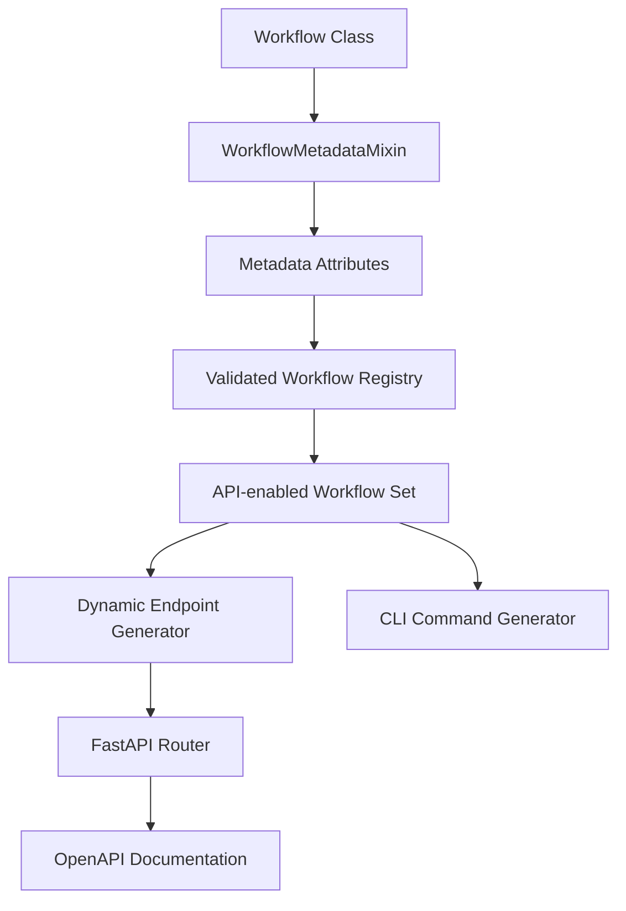

## Overview

The workflow API creates FastAPI endpoints from the validated workflow registry. Workflow classes define the execution endpoint, input model, and optional browser form contract.

## System Components

### WorkflowMetadataMixin

The `WorkflowMetadataMixin` allows workflows to define their API metadata directly in the workflow class:

- `workflow_description`: Human-readable description
- `workflow_name`: Human-readable workflow name
- `workflow_input_class`: Pydantic input model
- `workflow_api_enabled`: Set to `True` to expose the workflow through the API
- `workflow_api_endpoint`: API endpoint path
- `workflow_namespace`: Workflow namespace
- `workflow_group`: Launcher group
- `workflow_form_enabled` and `workflow_form_id`: Optional browser form and its stable public identifier

### Dynamic API Generator

The dynamic API generator:

- Creates routes for the workflow registry's workflows that set `workflow_api_enabled = True`; the registry rejects an API-enabled workflow with incomplete metadata at startup
- Generates FastAPI endpoint functions dynamically
- Handles proper routing, documentation, and parameter validation
- Provides consistent error handling and response formatting

### Workflow Examples

All workflows use the metadata system, including:

- **BackupWorkflow**: `/ngc/backup` - "Backup network device configuration to the Config Store and NVIDIA Config Manager plugin"
- **DeployWorkflow**: `/ngc/deploy` - "Deploy intended configuration to network device with approval workflow"
- **SpXOverlayCreationWorkflow**: `/ngc/spx_overlay_creation` - "Create a SpX Overlay with route distinguisher assignment and VRF/VXLAN provisioning"
- **SpXOverlayDeletionWorkflow**: `/ngc/spx_overlay_deletion` - "Delete a SpX Overlay and its associated VRFs/VXLANs with validation checks"
- **ReprovisionWorkflow**: `/ngc/reprovision` - "Reprovision a network device using pre- and post-ZTP backups"
- **ConnectedHostMetadataWorkflow**: `/ngc/connected_host_metadata` - "Discover and analyze connected hosts through MAC table and LLDP neighbor data"
- **HelloWorld**: `/hello_world`                                    - "Simple hello world workflow for testing and demonstration"
- **HelloWorldApproval**: `/hello_world_approval` - "Hello world workflow with approval step for testing staged workflows"

### Integrated Benefits

- CLI automatically discovers workflows and generates commands
- OpenAPI documentation is automatically generated
- Consistent parameter validation across all interfaces
- Single source of truth for workflow definitions

## Technical Implementation

### Workflow Definition with Metadata

```python
# Workflows define their metadata directly in the class
@workflow.defn
class BackupWorkflow(WorkflowMetadataMixin, StageMixin, DeviceMixin, ArchiveMixin):
    """Network device configuration backup workflow."""

    # Workflow metadata
    workflow_name = "Configuration Backup"
    workflow_group = "Configuration"
    workflow_description = (
        "Backup network device configuration to the Config Store and NVIDIA Config Manager plugin"
    )
    workflow_input_class = BackupInput
    workflow_api_enabled = True
    workflow_api_endpoint = "/ngc/backup"
    workflow_form_enabled = True
    workflow_form_id = "backup"
    workflow_namespace = "ngc"

    @workflow.run
    async def run(self, input_data: BackupInput) -> str:
        # Workflow implementation
        pass
```

### Automatic Endpoint Generation

```python
# In dynamic_endpoints.py - one POST route per API-enabled registry workflow
def register_dynamic_endpoints(router: APIRouter, workflows: Sequence[type] | None = None) -> None:
    """Register all workflow endpoints dynamically based on metadata."""
    for workflow_class in WORKFLOW_API_CATALOG if workflows is None else workflows:
        endpoint_path = workflow_class.get_workflow_api_endpoint()
        input_class = workflow_class.get_workflow_input_class()
        endpoint_func = create_workflow_endpoint(workflow_class, input_class, endpoint_path)
        router.post(
            endpoint_path,
            response_model=WorkflowResponse,
            summary=f"Execute {workflow_class.__name__}",
            description=workflow_class.get_workflow_description(),
        )(endpoint_func)
```

## Key Benefits

### Single Source of Truth

- Workflow metadata is defined once in the workflow class
- API endpoints, CLI help, and documentation all derive from the same source
- Consistent information across all interfaces

### Automatic Discovery

- New workflows are automatically discovered and exposed using the API
- CLI automatically generates commands for new workflows
- No manual endpoint registration required

### Easy Maintenance

- Adding a new workflow requires only:
  1. Adding `WorkflowMetadataMixin` to the workflow class
  1. Setting the metadata attributes, including `workflow_api_enabled = True`
  1. Adding to `BUILTIN_WORKFLOWS` or to a workflow plugin descriptor
- System automatically handles the rest

### Comprehensive Documentation

- Workflow descriptions appear in:
  - OpenAPI/Swagger documentation
  - CLI help text
  - Workflow discovery endpoints
- Consistent documentation across all interfaces

### Type Safety

- Pydantic input models ensure type safety
- FastAPI automatically generates request/response schemas
- CLI parameter validation matches API validation

## Architecture

### Workflow Discovery Flow



### Components

#### WorkflowMetadataMixin (`packages/workflows/src/nv_config_manager_workflows/metadata/mixin.py`)

The package defines the metadata attributes and their accessors. A registered
API workflow must supply a name, description, input model, and endpoint.
Browser forms are a separate opt-in contract; an API-enabled workflow does not
need a form. The package also supplies the async `canonicalize_input` hook for
HTTP-boundary validation.

#### Request Identity and Validation

`create_workflow_endpoint` validates the request body with the workflow's input
model before it starts an execution. Fields marked `ServerOwned`, such as
`BackupInput.user`, are replaced with identity from the authenticated request,
even when the caller submits another value. Unmarked legacy `user` and
`user_domain` fields are filled only when their submitted values are empty.

The endpoint then awaits `workflow_class.canonicalize_input(body)`. This hook
can normalize or reject an HTTP submission without changing the input model
used to deserialize existing Temporal histories. An `ApplicationError` from the
hook returns HTTP 422 with the `HTTPValidationError` envelope: `detail` is a
list of validation errors. It does not start a workflow.

The built-in Port LLDP Info workflow requires exactly one complete lookup
method, and Spectrum-X overlay creation requires `rd_min < rd_max`. Browser
checks do not replace these API checks. Direct Temporal callers bypass this
HTTP hook. The [workflow forms contract](https://github.com/dsx-ai-factory/nv-config-manager/blob/main/packages/workflows/README.md#workflow-forms)
describes field markers and plugin forms.

#### Registration System

The API builds one validated workflow registry snapshot when it is imported. If
the registry cannot be built, because an installed plugin is invalid or
conflicts with another, or because the built-in plugin is not registered
(`WorkflowPluginDiscoveryError`), the API fails to start. The API's dynamic
routes, `/metadata`, and `/types` read from the snapshot:

```python
# In workflow_catalog.py
WORKFLOW_REGISTRY = build_workflow_registry()
# API-enabled workflows: dynamic POST routes and /metadata.
WORKFLOW_API_CATALOG = tuple(WORKFLOW_REGISTRY.api_workflows)
# Every registered workflow, including API-disabled child workflows: /types.
WORKFLOW_TYPE_CATALOG = tuple(WORKFLOW_REGISTRY.all_workflows)

# In dynamic_endpoints.py
def register_dynamic_endpoints(router: APIRouter, workflows: Sequence[type] | None = None) -> None:
    """Register all workflow endpoints dynamically based on metadata."""
    for workflow_class in WORKFLOW_API_CATALOG if workflows is None else workflows:
        endpoint_path = workflow_class.get_workflow_api_endpoint()
        input_class = workflow_class.get_workflow_input_class()
        endpoint_func = create_workflow_endpoint(workflow_class, input_class, endpoint_path)

        router.post(
            endpoint_path,
            response_model=WorkflowResponse,
            summary=f"Execute {workflow_class.__name__}",
            description=workflow_class.get_workflow_description(),
        )(endpoint_func)
```

## Adding New Workflows

### Create Workflow with Metadata

```python
from nv_config_manager_workflows.metadata import WorkflowMetadataMixin

@workflow.defn
class MyNewWorkflow(WorkflowMetadataMixin, StageMixin):
    """My new workflow for doing amazing things."""

    # Workflow metadata
    workflow_name = "My New Workflow"
    workflow_description = "Perform amazing network operations with validation"
    workflow_input_class = MyNewWorkflowInput
    workflow_api_enabled = True
    workflow_api_endpoint = "/ngc/my_new_workflow"
    workflow_namespace = "ngc"

    @workflow.run
    async def run(self, input_data: MyNewWorkflowInput) -> str:
        # Workflow implementation
        pass
```

### Create Input Model

```python
class MyNewWorkflowInput(BaseModel):
    """Input model for MyNewWorkflow."""

    device_id: str
    operation_type: str
    validate_before: bool = True
```

### Register Workflow

Add a built-in workflow to `BUILTIN_WORKFLOWS`:

```python
# In packages/workflows/src/nv_config_manager_workflows/workflows/builtin.py
BUILTIN_WORKFLOWS = (
    # keep-sorted start
    # ... existing workflows
    MyNewWorkflow,
    # keep-sorted end
)
```

A workflow shipped in its own distribution belongs in that plugin's
`WorkflowPluginDescriptor` instead; see
[Registering a workflow plugin](https://github.com/dsx-ai-factory/nv-config-manager/blob/main/packages/workflows/README.md#registering-a-workflow-plugin).

### Result

The workflow is now automatically:

- Available using the API at `/v1/workflow/ngc/my_new_workflow`
- Documented in OpenAPI/Swagger
- Available in CLI as `uv run workflow-cli my-new-workflow`
- Included in workflow discovery endpoints

## Workflow Discovery API

### List Workflow Executions

```http
GET /v1/workflow/
```

Returns workflow execution summaries. Query parameters such as `workflow_type`,
`status`, `user`, `site`, `device_name`, `device_id`, `device_role`, and
`device_platform` filter the execution list.

### Get Registered Workflow Types

```http
GET /v1/workflow/types
```

Returns the class name of every registered workflow, including API-disabled
child workflows such as `TenantDeployWorkflow`. Use `/v1/workflow/metadata` for
the set of workflows the API can start.

### Get Workflow Metadata

```http
GET /v1/workflow/metadata
```

Returns metadata for each API-enabled workflow and the RBAC roles needed by the UI:

```json
{
  "workflows": [
    {
      "name": "BackupWorkflow",
      "display_name": "Configuration Backup",
      "description": "Backup network device configuration to the Config Store and NVIDIA Config Manager plugin",
      "endpoint": "/ngc/backup",
      "namespace": "ngc",
      "cli_name": "backup",
      "input_class": "BackupInput",
      "read_roles": ["all"],
      "execute_roles": ["all"]
    }
  ]
}
```

The `read_roles` and `execute_roles` values depend on the deployment's RBAC
configuration; the example above shows the default open configuration.

Request form-discovery metadata explicitly when building a workflow launcher:

```http
GET /v1/workflow/metadata?include=form
```

This representation adds `group`, `form_id`, and `has_form` to each workflow.
The request without `include=form` omits those keys so clients generated from
earlier versions of the API can continue decoding the response.

## Testing

### Unit Tests

```python
def test_workflow_metadata():
    """Test that workflow has complete metadata."""
    assert BackupWorkflow.has_complete_metadata()
    assert BackupWorkflow.get_workflow_description() == (
        "Backup network device configuration to the Config Store and NVIDIA Config Manager plugin"
    )
    assert BackupWorkflow.get_workflow_api_endpoint() == "/ngc/backup"
    assert BackupWorkflow.get_workflow_input_class() == BackupInput

def test_dynamic_endpoint_generation():
    """Test that endpoints are generated correctly."""
    router = APIRouter()
    register_dynamic_endpoints(router)

    # Check that backup endpoint was registered
    backup_route = next((route for route in router.routes if route.path == "/ngc/backup"), None)
    assert backup_route is not None
    assert "POST" in backup_route.methods
```

### Integration Tests

Use fixtures that provide an authenticated test client and mock the DCIM and
Temporal dependencies. A client-supplied certificate header does not establish
an authenticated identity.

```python
def test_backup_workflow_endpoint(client, access_token):
    """Test the backup endpoint with authenticated test fixtures."""
    response = client.post(
        "/v1/workflow/ngc/backup",
        json={
            "device_id": "12345678-1234-1234-1234-123456789abc",
            "trigger": "API",
        },
        headers={"Authorization": f"Bearer {access_token}"}
    )
    assert response.status_code == 200
    assert "id" in response.json()
    assert "href" in response.json()
```

## Browser Form Discovery

A form-enabled workflow declares a stable `workflow_form_id`. Use that ID with
`GET /v1/workflow/{form_id}/form` to retrieve its `schema`, `ui_schema`,
`ui_schema_version`, and required UI capabilities. The form projection leaves
execution request models and Temporal payloads unchanged.

A missing or disabled form returns HTTP 404. An invalid third-party form
returns HTTP 503 with `workflow_form_unavailable`, while its execution endpoint
remains available. Invalid built-in forms stop API startup. Upgrade the API
before the UI using the [browser-form upgrade order](../install/index.mdx#upgrade-order-for-browser-workflow-forms).
