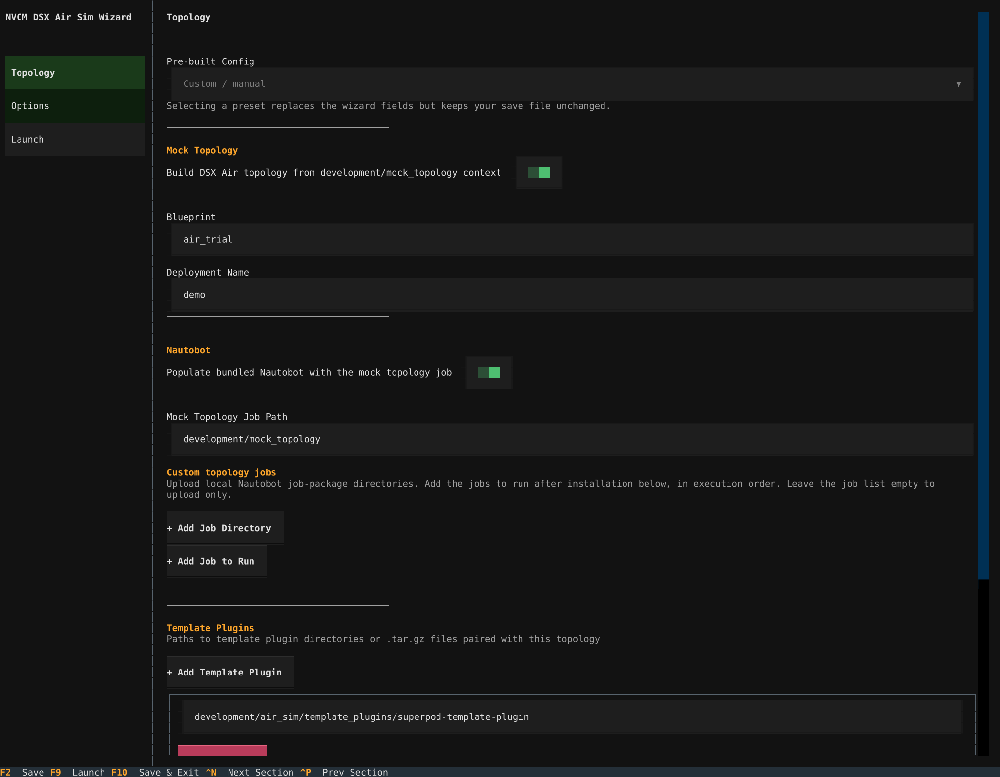
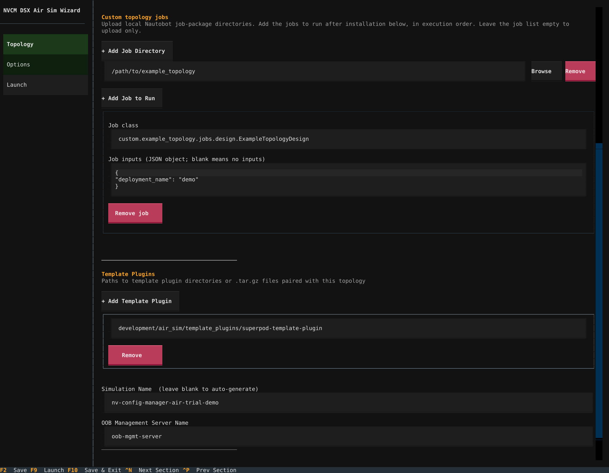
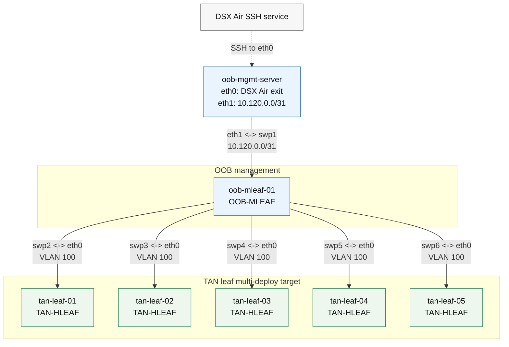
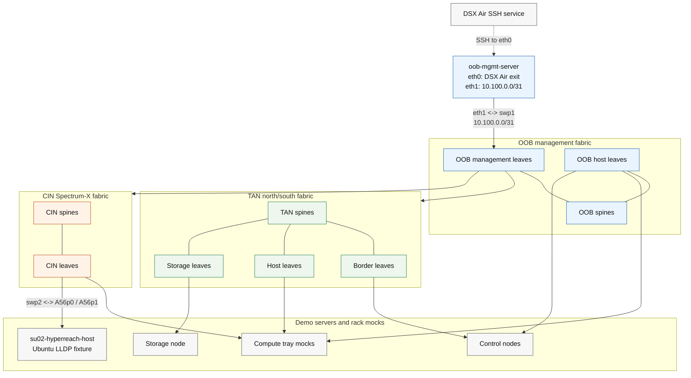
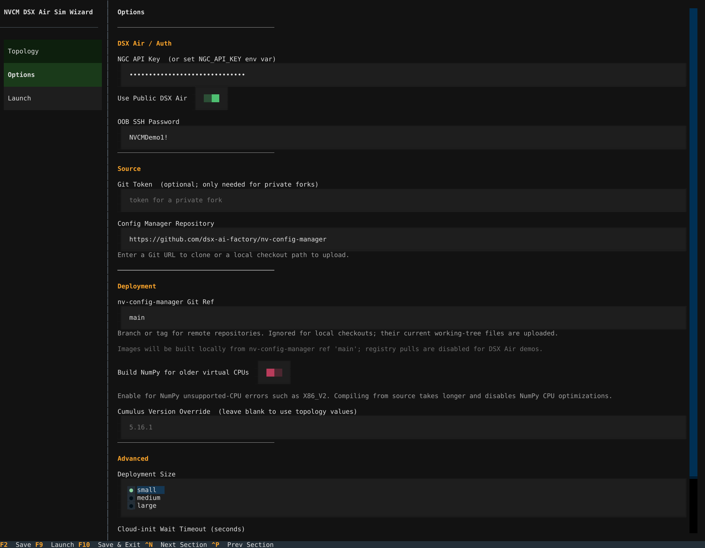
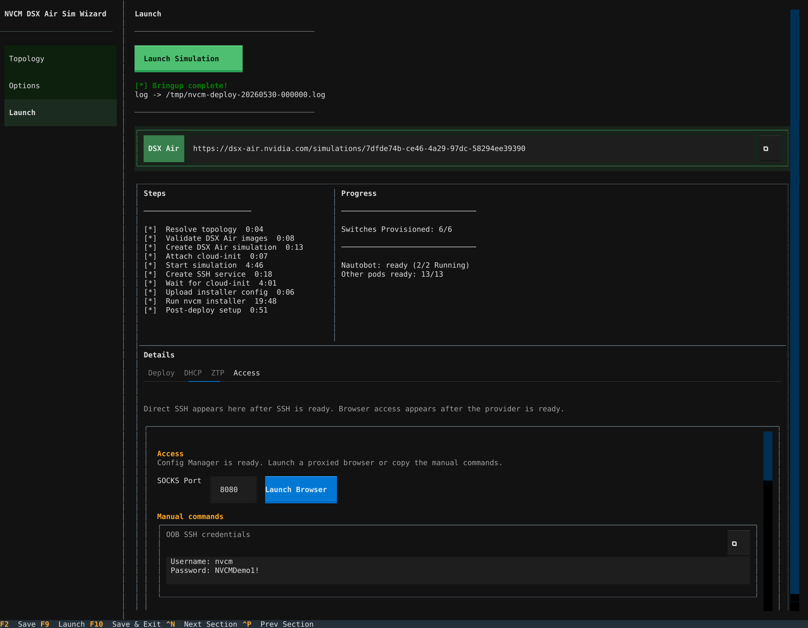
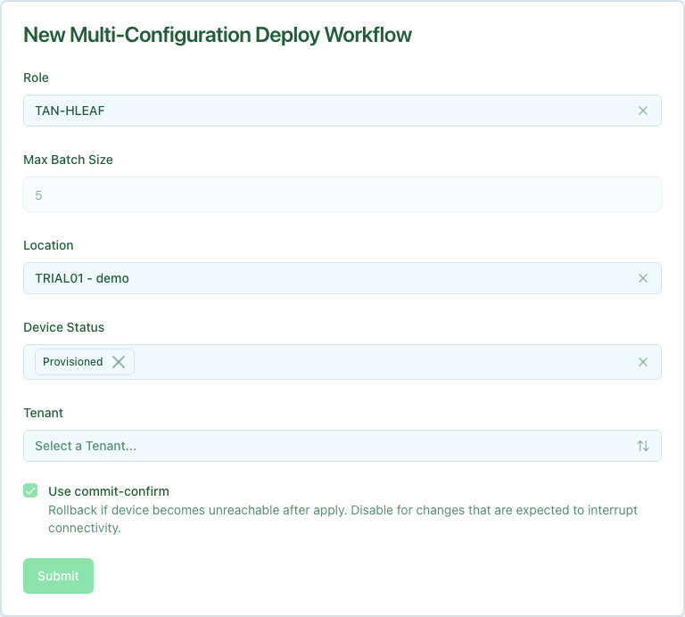
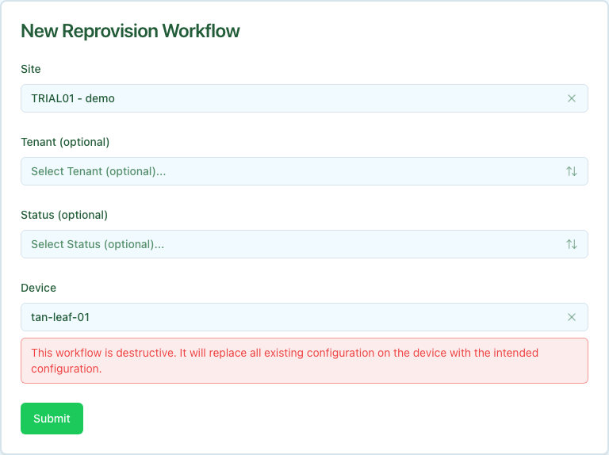

The Config Manager DSX Air simulation guide brings up a live NVIDIA DSX Air simulation, installs Config Manager inside the simulation, loads a demo Nautobot topology, and provisions virtual Cumulus Linux switches through DHCP and ZTP. Use it when you want to validate real device-facing workflows without touching a physical lab.

This is different from the [Local Development Quick Start](../../getting-started/local-development-quick-start.mdx). The local quick start is render-only. The DSX Air simulation runs Cumulus Linux switch nodes and exercises Config Manager against those nodes over the simulated management network.

<Note>
Most Config Manager workflows that operate on the demo Ethernet Cumulus switches can be exercised in DSX Air. InfiniBand and NVLink workflows are not included because DSX Air does not currently simulate those fabrics for this demo. Switch OS Upgrade is also excluded because the ONIE install path does not work in DSX Air.
</Note>

## Prerequisites

Before running the Config Manager DSX Air simulation, review the public NVIDIA DSX Air documentation:

- [NVIDIA DSX Air Account Setup](https://docs.nvidia.com/networking-ethernet-software/nvidia-air-v2/Account-Setup/) - NGC account, organization selection, free trial, and DSX Air roles.
- [NVIDIA DSX Air Quick Start](https://docs.nvidia.com/networking-ethernet-software/guides/nvidia-air/Quick-Start/) - simulation navigation, services, node consoles, SSH keys, and API authentication.

You also need:

- A local clone of the [Config Manager repository](https://github.com/dsx-ai-factory/nv-config-manager)
- Python 3.13+ and `uv`.
- `sshpass` installed on the workstation where you run the TUI. The TUI-generated DSX Air SSH and SOCKS proxy commands use it.
- An NGC API key for DSX Air API authentication. You can paste it into the TUI or set `NGC_API_KEY` in your shell.
- Enough DSX Air capacity for the selected demo. The DSX Air free trial preset is resource-capped for public trial accounts.
- A workstation browser that can run through a SOCKS proxy. Chromium-family browsers are easiest because the TUI prints ready-to-run commands.

## Start the TUI

From your Config Manager fork checkout:

```bash
cd installer
uv sync
uv run nvcm-installer air-sim init
```

The TUI writes `~/.nvcm-air-sim.yaml` by default so API keys and generated DSX Air SSH credentials are not saved inside the Git checkout. Treat the file as sensitive if it contains your NGC API key. To use a different location outside the repository, pass `--config /path/to/config.yaml` or set `NVCM_AIR_CONFIG`.

You can also run a saved simulation config headlessly:

```bash
cd installer
uv run nvcm-installer air-sim deploy --config ~/.nvcm-air-sim.yaml
```

## TUI Walkthrough

The DSX Air simulation TUI has three sections: Topology, Options, and Launch.

### Topology

Use the **Pre-built Config** selector for the built-in demos. For most users, start with **DSX Air free trial demo**. It creates one OOB management leaf and five `TAN-HLEAF` Cumulus switches, which is enough to exercise ZTP, backup, deploy, multi-deploy, reprovision, and validation workflows.

The preset enables **Mock Topology**, points the loader at `development/mock_topology`, and configures the template plugin paired with the demo topology. Keep the paired template plugin in place; the prebuilt demos require those templates to render valid device configuration.



Important fields:

| Field | Description |
| :---- | :---------- |
| **Pre-built Config** | Loads the DSX Air trial or SuperPOD demo values into the TUI. |
| **Mock Topology** | Builds DSX Air topology and Nautobot data from `development/mock_topology` instead of a hand-authored DSX Air topology YAML. |
| **Blueprint** | Mock topology blueprint, such as `air_trial`. |
| **Deployment Name** | Suffix used by the mock topology job. For the DSX Air trial preset, this is `demo`. |
| **Template Plugins** | Template plugin directories or archives paired with the selected topology. |
| **Simulation Name** | Name shown in DSX Air. Leave blank to auto-generate. |
| **OOB Management Server Name** | Existing DSX Air server node that receives Config Manager, usually `oob-mgmt-server`. |

### Custom SimX topology options

Custom site-design YAML can retain SimX hosts and their simulated NICs. Put the
Air node settings under the device's `_air` key, and put the NIC identifier under
the interface's `_air.network_pci` key. The identifier must match an entry in
that same device's `_air.network_pci` mapping. For example, these entries define
one host with two ports on the same simulated ConnectX-8 NIC:

```yaml
devices:
  - name: simx-host01
    platform: Ubuntu
    _air:
      os: <available-doca-host-image>
      cpu: 4
      memory: 8192
      storage: 20
      emulation_type: HOST
      config_only_features: true
      model: host
      simulator_image: <available-simx-image>
      network_pci:
        nic0:
          emulation_type: NIC_ETHERNET
          model: connectx8
          dpa: true
          port_type: ethernet
          number_of_ports: 2
          pci_addresses: ["0000:03:00.0", "0000:03:00.1"]
interfaces:
  - device: simx-host01
    name: eth_p0
    _air:
      network_pci: nic0
  - device: simx-host01
    name: eth_p1
    _air:
      network_pci: nic0
```

This is a site-design excerpt. Add the host's management interface and fabric
cables, the NVCM management server and addressing, and matching Nautobot inventory
and configuration templates for the complete lab. For a mock topology blueprint,
put the same `_air` settings on the device and its nested interfaces in the
blueprint's device JSON. The context converter preserves both.

The builder passes through `emulation_type`, `config_only_features`, `model`,
`simulator_image`, and `network_pci`, including nested NIC settings. It also
preserves explicit `cpu_mode`, `cpu_options`, `nic_model`, `secureboot`, `pxehost`,
`features`, `storage_pci`, `labels`, and `positioning` settings. These options and
explicit CPU, memory, and storage values apply to both hosts and Cumulus nodes.
Cumulus OS images continue to be selected from `intended-firmware.version` and
resolved against Air; `_air.os` selects the image for non-Cumulus nodes only.

Use full topology mode for all SimX settings, including hosts that specify only
a simulator image or emulation mode without a NIC mapping. Minimal mode rejects
SimX settings because grouping devices would lose their simulator, PCI, and cable
associations. Minimal mode retains its existing render-only behavior for ordinary
designs: it produces generic Cumulus groups and discards custom host OS and VM
options. Use full mode whenever those options must be preserved.
Image availability, SimX access, and remaining option validation depend on the
target Air organization. This support uses the existing site-design workflow;
native Air JSON import and attaching to a running simulation are separate workflows.

### Custom Nautobot topology jobs

Under **Topology → Nautobot → Custom topology jobs**:

1. Select **Add Job Directory** and choose the local job-package directory, for
   example `/path/to/example_topology`. The directory and its contents are
   uploaded to the simulation during installation.
1. Select **Add Job to Run** and enter its full Nautobot job class, for example
   `custom.example_topology.jobs.design.ExampleTopologyDesign`.
1. Enter the job's inputs as a JSON object, such as
   `{"deployment_name": "demo"}`. Blank inputs, including an empty or `null` YAML
   `input`, mean no arguments. Jobs run in the displayed order after installation,
   following the mock job if enabled.
1. Save the profile or launch the simulation. Invalid JSON and non-object inputs
   are rejected before Air resources are created.



For a custom job that replaces the bundled inventory, turn off **Populate bundled
Nautobot with the mock topology job**. The Air topology YAML, Nautobot population
job, and template plugins are separate selections; keep them aligned with the
same design. A preview-only job does not populate the inventory needed for
automatic switch provisioning.

Directories can be uploaded without adding a job to run. Multiple jobs may use
the same directory. These controls edit the existing `extra_job_paths` and
`extra_run_after_deploy` settings, including profiles created outside the TUI.
Do not enter passwords or tokens as job inputs; resolve credentials through your
job's runtime secret integration.

### DSX Air trial topology



### SuperPOD demo topology



### SuperPOD hyper-reach LLDP fixture

New SuperPOD simulations include `su02-hyperreach-host` to test cable identity
through LLDP port descriptions. Existing simulations must be recreated from the
updated topology to receive this host and its cables.

| CIN leaf | Switch port | Nautobot host interface | Intended label | Observed port ID |
| :------- | :---------- | :---------------------- | :------------- | :--------------- |
| su01-cin-leaf-r01 | swp2 | eth1 | C1-2-L1 | A56p0 |
| su01-cin-leaf-r02 | swp2 | eth2 | C1-2-L2 | A56p1 |

The host advertises `su02-hyperreach-host C1-2-L1` and
`su02-hyperreach-host C1-2-L2`. The two data interfaces have no IP addresses or
intended MAC addresses. The original SpX compute hosts and their `swp1` links
remain available; use those hosts for SpX tests and keep the fixture's `swp2`
ports out of tenant-change tests.

1. Open the host's console from the DSX Air topology. Wait for
   `cloud-init status --wait` to complete.
1. Run [Connected Host Metadata](../connected-host-metadata/index.mdx) against
   each CIN leaf to compare intended labels with observed descriptions. Then
   run [Cable Validation](../cable-validation/index.mdx); both `swp2` links
   should validate even though the observed port IDs differ from Nautobot's
   interface names.
1. For a metadata-difference test, run this in the host console:

   ```sh
   sudo lldpcli configure ports A56p0 lldp portdescription "su02-hyperreach-host A56p0"
   ```

   Wait for LLDP to refresh, then rerun validation. The first leaf's `swp2`
   should fail identity validation, with `C1-2-L1` and `A56p0` visible in
   the report and **Port naming differs** guidance in the Issue column. This flags differing metadata;
   alternative naming conventions can refer to the same physical lane. The
   second leaf's `swp2` should remain valid.
1. Restore the persistent descriptions with `sudo systemctl restart lldpd`,
   wait for LLDP to refresh, and rerun validation.

The fixture covers description and label matching. It does not model physical
PCIe line cards or test Nautobot `parent_bay` chassis resolution.

### Options

Use **Options** to set DSX Air authentication, source settings, and advanced timing values.



Recommended public DSX Air values:

| Field | Recommended value |
| :---- | :---------------- |
| **NGC API Key** | Your DSX Air-capable NGC API key, or leave blank if `NGC_API_KEY` is set. |
| **Use Public DSX Air** | On. |
| **OOB SSH Password** | Generated by the TUI for `nvcm` SSH access to `oob-mgmt-server`. Change it before launch if desired. |
| **Git Token** | Blank for the public `dsx-ai-factory/nv-config-manager` repository. |
| **nv-config-manager Git Ref** | `main`, unless you are testing a branch that contains unreleased DSX Air sim code. |
| **Deployment Size** | Under **Advanced**. Use `small` for the public DSX Air trial demo. |

### Launch

The **Launch** screen creates the simulation, starts it, waits for SSH, deploys Config Manager, runs post-deploy Nautobot jobs, monitors pods, and follows DHCP/ZTP logs.


Click **Launch Simulation** and leave the TUI open. The launch can take a while because it boots the DSX Air nodes, builds and loads local images, installs Config Manager, and lets the switches provision.

<Warning title="TUI responsiveness">
During launch, the Activity stream can receive a high volume of log output.
Mouse clicks may be delayed while the TUI processes those logs. If a click does
not respond immediately, wait a moment and try again.
</Warning>

During launch:

- **Steps** shows high-level orchestration progress.
- **Progress** highlights the Nautobot pod first, then the remaining Kubernetes pods, and labels the ZTP count as **Switches Provisioned**.
- **Activity** has separate **Deploy**, **DHCP**, **ZTP**, and **Access** tabs. Deploy output appears first. DHCP and ZTP events populate while the switches request leases, pull ZTP data, and report provisioned state.
- **DSX Air**, **SSH**, and **Access** panels appear as soon as the TUI has enough information to show them. The deploy log path remains visible after completion or failure.


Use the **DHCP** tab to follow lease activity as the switches boot and request management addresses.


Use the **ZTP** tab to follow switch callbacks into the ZTP service and confirm each device reports progress.


When bringup completes, the **Access** panel shows commands for reaching the simulation.



## Access the Simulation

Config Manager runs inside the `oob-mgmt-server` node in DSX Air. The TUI creates a DSX Air SSH service to that server and prints copyable commands. The Access panel also shows the generated `nvcm` SSH password under **OOB SSH credentials**.

For Linux and macOS:

1. Copy the **Linux / macOS - SOCKS tunnel** command from the Access panel and run it in a terminal.
1. If `8080` is already in use on your workstation, change **SOCKS Port** in the Access panel before copying commands or launching a browser.
1. Copy the **Linux / macOS - browser** command to open the Config Manager UI, or manually launch a browser with `socks5://localhost:<SOCKS_PORT>`.
1. Open the Config Manager and Nautobot URLs through that browser session.

Common service URLs inside the SOCKS-proxied browser are:

| Service | URL |
| :------ | :-- |
| Config Manager UI | `https://nvcm.air` |
| Nautobot | `https://nautobot.nvcm.air` |
| Workflow API | `https://workflow.nvcm.air` |
| Config Store API | `https://config-store.nvcm.air` |
| Render API | `https://render.nvcm.air` |
| DHCP API | `https://dhcp.nvcm.air` |
| ZTP API | `https://ztp.nvcm.air` |

The demo disables SSO. Nautobot credentials are `demo` / `demo`. Config Manager workflow RBAC is opened for the demo so the workflow forms can be exercised without identity-provider setup.

<Note>
DNS resolution for `*.nvcm.air` must go through the SOCKS tunnel. If a browser resolves names locally before using the proxy, the URLs will fail even though the services are healthy.
</Note>

You can also SSH directly to the DSX Air server with the SSH command shown at the top of the Launch screen. This is useful for `kubectl` checks, pod logs, and low-level troubleshooting.

## What to Check After Bringup

After launch completes:

1. Open Nautobot and confirm the demo site, devices, interfaces, IP addresses, cables, roles, platforms, and config contexts exist.
1. Open Config Manager and confirm workflow forms are available.
1. Open Config Store and confirm intended configs exist for `tan-leaf-01` through `tan-leaf-05`.
1. In Nautobot, confirm the TAN leaf devices have status **Provisioned** after ZTP completes.
1. In the TUI, use the **Activity** panel to inspect DHCP and ZTP service activity if a device is still provisioning.

## Workflow Support

The DSX Air demo is intended for Ethernet and Cumulus Linux workflows. Useful workflows to try include:

- Configuration Backup
- Configuration Deploy
- Batch Deploy
- Multi-Device Deploy
- Spectrum-X Overlay Tenant Change, for supported demo tenant assignments
- Cable Validation
- Hardware Validation
- Device Reprovision
- Workflow lifecycle actions such as approve, reject, retry, and terminate

Do not use the DSX Air demo for:

| Workflow family | Why it is excluded |
| :-------------- | :----------------- |
| InfiniBand workflows | DSX Air does not simulate the InfiniBand fabric for this demo. |
| NVLink switch workflows | DSX Air does not simulate NVLink switches for this demo. |
| Switch OS Upgrade | DSX Air cannot complete the ONIE install path used by the OS upgrade workflow. |

## Try Multi-Deploy

Multi-Deploy is a good first Day-2 workflow because the DSX Air trial demo has five `TAN-HLEAF` switches that should receive the same diff.

The standard demo context already includes `8.8.8.8` as a DNS server. The example below appends `8.8.4.4` to the site config context. The render service picks up the Nautobot change, produces new intended configs for the TAN leaf devices, and Multi-Deploy groups the identical diffs for approval.

### Edit the DNS config context

1. Open `https://nautobot.nvcm.air`.
1. Log in as `demo` / `demo`.
1. Navigate to **Extensibility > Config Contexts**.
1. Open `air-trial-network-management-services - demo`.
1. Edit the **Data** field.
1. Add `8.8.4.4` to the existing `dns.ipv4` list.

   Example data with a demo DNS server:

   ```json
   {
     "ztp": {
       "ipv4": [
         "172.18.255.201"
       ]
     },
     "dhcp": {
       "nvcm": {
         "ipv4": [
           "172.18.255.202"
         ]
       }
     },
     "management_prefixes": {
       "ipv4": [
         "172.18.0.0/16"
       ]
     },
     "provisioning_servers": {
       "ipv4": [
         "10.120.0.0"
       ]
     },
     "dns": {
       "ipv4": [
         "8.8.8.8",
         "8.8.4.4"
       ]
     }
   }
   ```

1. Save the config context.
1. Wait for render to regenerate intended configs. If no intended config changes appear after a short wait, make a no-op edit to the context or call `POST /v1/render/all` from the Render API at `https://render.nvcm.air/docs`.

### Run Multi-Deploy

1. Open `https://nvcm.air`.
1. Click the **+** button and select **MultiDeployWorkflow**.
1. Set **Role** to `TAN-HLEAF`.
1. Set **Max Batch Size** to `5` so all demo TAN leaf devices can be approved together when they share one diff.

   The populated DSX Air trial form should look similar to this:

   

1. Submit the workflow.
1. When the parent reaches the batch execution stage, open the child Batch Deploy link.
1. Review the shared diff. It should show the DNS server addition on each `tan-leaf-*` device.
1. Approve the batch.
1. Confirm the parent workflow completes and the child batch reports successful applies and backups.

For the full workflow behavior, see [Multi-Device Deploy](../multi-deploy/index.mdx) and [Batch Deploy](../batch-deploy/index.mdx).

## Try Reprovision

Reprovision shows the re-ZTP path for an already-running switch. It factory-resets the target Cumulus switch, waits for DHCP/ZTP to run again, and then triggers a fresh backup.

<Warning title="Device reset">
Reprovision intentionally takes the selected switch offline and wipes its running configuration. In the DSX Air demo this is safe, but the same workflow is disruptive in a real environment.
</Warning>

1. Open `https://nvcm.air`.
1. Click the **+** button and select **ReprovisionWorkflow**.
1. Select the DSX Air trial site, such as `TRIAL01 - demo`.
1. Select a TAN leaf device, such as `tan-leaf-01`.

   The populated DSX Air trial form should look similar to this:

   

1. Submit the workflow.
1. In the DSX Air UI, open the simulation topology.
1. Double-click the same switch node to open its console.
1. On the switch console, tail the Cumulus autoprovision log:

   ```bash
   sudo tail -f /var/log/autoprovision
   ```

   This lets you watch the switch-side ZTP process while Config Manager waits for the device to report provisioned.

1. In the Config Manager UI, watch the three Reprovision stages:

   - `pre_reprovision_backup` links to the pre-ZTP backup, where configuration drift details are reported.
   - `execute_ztp` factory-resets the switch and waits for ZTP to finish.
   - `perform_backup` links to the post-ZTP backup.

1. Confirm the workflow completes after ZTP succeeds and the post-ZTP backup child workflow finishes.
1. In Nautobot, confirm the device status returns to **Provisioned**.

You can also watch the TUI **Activity** panel or correlate the ZTP `http-lb`
and `sftp` container logs if the switch stalls. The boot request appears in
`http-lb`; the default rendered-configuration transfer appears in `sftp`. For
the full production workflow details, see [Device Reprovision](../reprovision/index.mdx).

## Other Useful Exercises

After Multi-Deploy and Reprovision, try these workflows:

- **Configuration Backup** against one TAN leaf. Confirm the backup appears in Config Store.
- **Configuration Deploy** against one TAN leaf after a small Nautobot config context change. Use this before Multi-Deploy if you want to inspect the single-device approval path.
- **Cable Validation** for the DSX Air trial site. This checks LLDP-reported neighbors against the mock topology's Nautobot cabling.

## Cleanup

DSX Air simulations consume account resources while running. When you are done, stop or delete the simulation in the DSX Air UI. If you expect to resume later, use DSX Air checkpoints according to your account limits. If you only needed a short demo, delete the simulation to free capacity.

The TUI-created Config Manager deployment lives inside the DSX Air simulation. Deleting the simulation removes the demo Kubernetes cluster, Nautobot data, Config Store data, and generated switch state.
