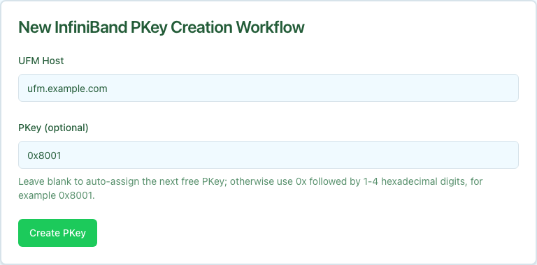

The InfiniBand PKey Creation workflow provisions a new InfiniBand Partition Key (PKey) on the UFM subnet manager and records it in Nautobot. A PKey is the IB fabric's tenant-isolation primitive — the per-tenant equivalent of a VLAN in Ethernet networks. Member interfaces are added in a separate step through [IB PKey Member Add](../ib-pkey-member-add/index.mdx).

Creation is idempotent on the canonical PKey value. Re-running with an existing PKey returns the existing record rather than allocating a duplicate.

## Prerequisites

Before running, confirm:

- **UFM device modeled in Nautobot.** The workflow looks up the device named in **UFM Host** to derive the site that owns the UFM credentials.
- **UFM credentials configured.** Site-scoped (or global) UFM credentials must be loaded by the installer. See [Install Guide → UFM Credentials](../../install/index.mdx) for the configuration keys and rotation behavior.
- **A free PKey in the allocation range.** The default range is `0x0001`–`0x7FFE`. Either let the workflow auto-pick the next free value, or pass an explicit PKey that is not already allocated on UFM.

## Running the workflow

1. Navigate to the Config Manager URL for your environment.
1. Click the **+** in the top right and select **InfiniBand PKey Creation**.
1. Fill in the form using the field reference below and submit.

| Field | Description | Required |
| :---- | :---------- | :------- |
| **UFM Host** | Nautobot device name (or hostname) of the UFM server that owns the PKey. | Yes |
| **PKey** | Specific partition key to allocate, for example `0x8001`. Leave blank to auto-assign the next free value in `[0x0001, 0x7FFE]`. | No |

After submission, a status page shows the five execution stages.

## Execution stages

The workflow runs five stages. No approval is required.

1. **`resolve_context` — Resolve the UFM device's site.**

   Looks up `host` in Nautobot to derive the device's Site for credential resolution. Skipped when `site` is supplied through the API.

1. **`validate_pkey` — Confirm PKey availability on UFM.**

   Fetches the current PKey list from UFM and either picks the next free value in the allocation range (when **PKey** was left blank) or asserts that the user-supplied PKey is not already allocated.

1. **`create_pkey` — Create the PKey on UFM.**

   Calls the UFM REST API to allocate the partition. The stage records whether the PKey was newly created or already existed.

1. **`verify_pkey` — Confirm propagation by the SM.**

   Re-reads the PKey from UFM to verify the subnet manager has accepted it and it is queryable.

1. **`record_nautobot` — Persist the PKey in Nautobot.**

   Writes an `InfiniBandPKey` row in Nautobot, which becomes the source of truth for which PKey values are in use.

## Verifying outcomes

After the workflow reports success, confirm:

- **All five stages show green** in the workflow status page.
- **UFM lists the PKey.** Hit `GET /ufmRest/resources/pkeys` on the UFM server and look for the canonical `0xNNNN` value in the response.
- **Nautobot lists the PKey.** Open **Multi-Tenancy → InfiniBand PKeys** in Nautobot and confirm the new entry exists with the expected value.

## Common issues

**`validate_pkey` fails with "PKey already exists on UFM".**

The supplied PKey is already allocated. Pick a different value, or use auto-assign by leaving **PKey** blank.

**`validate_pkey` fails with "No PKeys available in the range".**

The allocation window is exhausted. Widen `pkey_min`/`pkey_max` via the API, or audit existing PKeys on UFM and reclaim unused values before retrying.

**`create_pkey` succeeds but `verify_pkey` fails.**

UFM accepted the PKey but the subnet manager has not yet propagated it. This is usually transient. Wait briefly and retry the stage, or re-run the workflow.

**`resolve_context` fails with "UFM device not found in Nautobot".**

The value typed in **UFM Host** does not match any device name in Nautobot. Confirm the device is modeled and that you used its Nautobot name, not an IP or DNS alias.

## Related guides

- [IB PKey Member Add](../ib-pkey-member-add/index.mdx) — add device interfaces to the new PKey.
- [IB PKey Member Update](../ib-pkey-member-update/index.mdx) — reconcile membership to a declarative interface list.
- [IB PKey Member Delete](../ib-pkey-member-delete/index.mdx) — remove device interfaces from the PKey.
