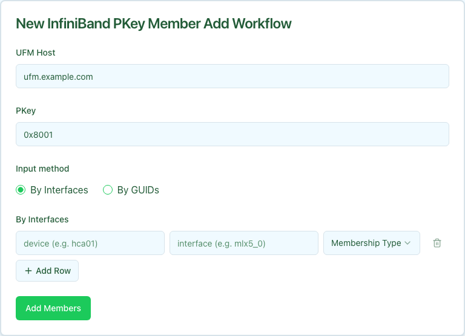

The InfiniBand PKey Member Add workflow attaches device interfaces to an existing InfiniBand PKey partition on UFM and records the corresponding `OverlayAssignment` rows in Nautobot. Use this after creating the PKey with [IB PKey Creation](../ib-pkey-creation/index.mdx).

Members can be specified by Nautobot interface (`device` + `interface`, resolved to a GUID server-side) or by raw IB GUID. Pick one mode per submission.

Add is additive. Members already attached to the PKey are not re-added.

## Prerequisites

Before running, confirm:

- **PKey exists.** Create it first with [IB PKey Creation](../ib-pkey-creation/index.mdx) or by another mechanism. The workflow fails if the PKey is not present on UFM.
- **By-Interfaces mode requires `ib_guid` in Nautobot.** Each interface must carry a `custom_fields.ib_guid` value matching `0x` + 16 hex characters. The resolver fails fast with the offending `device/interface` pair if any are missing.
- **UFM credentials available.** Same requirement as PKey Creation.

## Running the workflow

1. Navigate to the Config Manager URL for your environment.
1. Click the **+** in the top right and select **InfiniBand PKey Member Add**.
1. Fill in the form using the field reference below and submit.

| Field | Description | Required |
| :---- | :---------- | :------- |
| **UFM Host** | Nautobot device name of the UFM server that owns the PKey. | Yes |
| **PKey** | Partition key the members are joining, for example `0x8001`. | Yes |
| **Membership Type** | `full` (read/write) or `limited` (read-only). Defaults to `full`. | Yes |
| **Member Source** | `By Interfaces` accepts `device/interface` rows. `By GUIDs` accepts raw `0x` + 16 hex GUIDs, one per line or comma-separated. | Yes |
| **Interfaces** / **GUIDs** | The list itself, depending on **Member Source**. | At least one row/GUID required |

After submission, a status page shows the five execution stages.

## Execution stages

The workflow runs five stages. No approval is required.

1. **`resolve_context` — Resolve site, overlay, and canonical PKey from Nautobot.**

   Looks up the UFM host to derive its site, normalizes the PKey to canonical `0xNNNN`, and finds (or lazily creates) the Overlay record that holds the assignments. The lazy-create only fires when an orphan PKey row exists with no Overlay; the new Overlay is placed at the device's Site.

1. **`resolve_guids` — Resolve members to IB GUIDs.**

   In By-Interfaces mode, each `device/interface` is looked up in Nautobot and its `custom_fields.ib_guid` extracted. In By-GUIDs mode, the raw GUIDs are validated and resolved back to interface records when possible (for OverlayAssignment writes downstream).

1. **`add_members` — Add GUIDs to PKey on UFM.**

   Calls UFM to attach the resolved GUIDs with the requested **Membership Type**. UFM is idempotent on duplicates.

1. **`verify_members` — Confirm GUIDs are present in PKey on UFM.**

   Re-reads the PKey member list from UFM and asserts every submitted GUID is present.

1. **`record_assignments` — Write OverlayAssignment rows in Nautobot.**

   Creates an `OverlayAssignment` linking the PKey's Overlay to each resolved interface so Nautobot reflects the new membership state.

## Verifying outcomes

After the workflow reports success, confirm:

- **All five stages show green.**
- **UFM reflects the new members.** `GET /ufmRest/resources/pkeys/<pkey>?guids_data=true` should list every submitted GUID with the chosen membership type.
- **Nautobot reflects the new assignments.** Open the Overlay record in Nautobot's **Multi-Tenancy → Overlays** view and confirm an `OverlayAssignment` exists for each interface.

## Common issues

**`resolve_guids` fails with "interface missing ib_guid".**

The named interface exists in Nautobot but its `custom_fields.ib_guid` field is empty. Populate it (for example via the [IB Port GUID Discovery](../ib-port-guid-discovery/index.mdx) workflow) before re-running, or switch to By-GUIDs mode if you already have the raw values.

**`resolve_guids` fails with "device/interface not found".**

The `device` or `interface` you submitted does not match any Nautobot record. Check spelling and confirm the interface is modeled.

**`add_members` fails with "PKey not found".**

The PKey does not exist on UFM. Run [IB PKey Creation](../ib-pkey-creation/index.mdx) first.

**`verify_members` fails.**

UFM accepted the add call but membership did not propagate. Usually transient. Re-run the workflow or retry the stage.

## Related guides

- [IB PKey Creation](../ib-pkey-creation/index.mdx) — allocate the PKey before adding members.
- [IB PKey Member Update](../ib-pkey-member-update/index.mdx) — reconcile membership to a declarative list (use when you want to replace, not extend).
- [IB PKey Member Delete](../ib-pkey-member-delete/index.mdx) — remove specific members.
