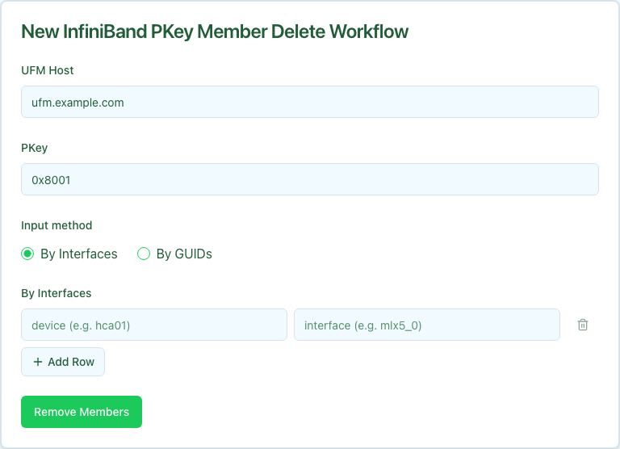

The InfiniBand PKey Member Delete workflow removes specific device interfaces from an existing PKey on UFM and deletes the matching `OverlayAssignment` rows in Nautobot. Other PKey members are left alone.

Members can be specified by Nautobot interface (`device` + `interface`, resolved to a GUID server-side) or by raw IB GUID. Removing a GUID that is not currently in the PKey is a no-op.

## Prerequisites

Before running, confirm:

- **PKey exists** on UFM. The workflow fails fast if it does not.
- **By-Interfaces mode requires `ib_guid` in Nautobot.** Each interface must carry a `custom_fields.ib_guid`. By-GUIDs mode bypasses this requirement.

## Running the workflow

1. Navigate to the Config Manager URL for your environment.
1. Click the **+** in the top right and select **InfiniBand PKey Member Delete**.
1. Fill in the form using the field reference below and submit.

| Field | Description | Required |
| :---- | :---------- | :------- |
| **UFM Host** | Nautobot device name of the UFM server that owns the PKey. | Yes |
| **PKey** | Partition key the members are being removed from. | Yes |
| **Member Source** | `By Interfaces` or `By GUIDs`. | Yes |
| **Interfaces** / **GUIDs** | The members to remove. | At least one row/GUID required |

After submission, a status page shows the five execution stages.

## Execution stages

The workflow runs five stages. No approval is required.

1. **`resolve_context` — Resolve site, overlay, and canonical PKey from Nautobot.**

1. **`resolve_guids` — Resolve members to IB GUIDs.**

   Same resolution logic as the Add and Update workflows.

1. **`remove_members` — Remove GUIDs from the PKey on UFM.**

   Calls UFM to detach the resolved GUIDs. UFM treats removal of a non-member GUID as a no-op.

1. **`verify_removed` — Confirm the GUIDs are absent from the PKey on UFM.**

   Re-reads the PKey member list and asserts none of the submitted GUIDs remain.

1. **`remove_assignments` — Delete OverlayAssignment records in Nautobot.**

   Removes the matching `OverlayAssignment` rows. Interfaces that had no assignment (already deleted, or never created) are returned in `interface_ids_not_assigned` rather than failing the stage.

## Verifying outcomes

After the workflow reports success, confirm:

- **All five stages show green.**
- **UFM no longer lists the removed GUIDs** in the PKey member set.
- **Nautobot no longer lists the removed interfaces** under the Overlay's `OverlayAssignments`.
- **`members_removed`** in the workflow output equals the number of GUIDs you submitted (allowing for any no-op removals that were already absent).

## Common issues

**`remove_members` reports zero removals even though the request had members.**

The submitted GUIDs were not in the PKey to begin with. Confirm the values match what UFM actually has by hitting `GET /ufmRest/resources/pkeys/<pkey>?guids_data=true`.

**`verify_removed` fails.**

UFM accepted the removal call but the change did not propagate. Usually transient. Re-run the workflow or retry the stage.

**`remove_assignments` reports `interface_ids_not_assigned`.**

The interfaces existed in Nautobot but no `OverlayAssignment` was present for them. This is expected when membership had been added directly on UFM (not through this workflow family) or when assignments were already cleaned up out-of-band. Not a failure mode.

## Related guides

- [IB PKey Creation](../ib-pkey-creation/index.mdx) — create the PKey.
- [IB PKey Member Add](../ib-pkey-member-add/index.mdx) — add members.
- [IB PKey Member Update](../ib-pkey-member-update/index.mdx) — reconcile membership to a declarative list (alternative when you want to replace, not delete).
