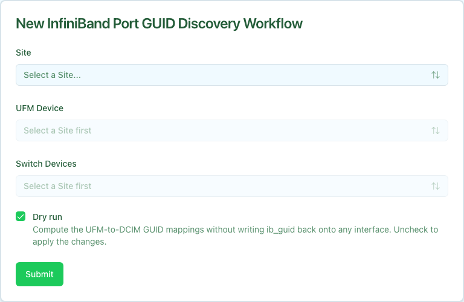

The InfiniBand Port GUID Discovery workflow reads port GUIDs from UFM and writes them onto the matching Nautobot interfaces (`custom_fields.ib_guid`). Run it to populate `ib_guid` before workflows that consume it, such as [IB PKey Member Add](../ib-pkey-member-add/index.mdx) in By-Interfaces mode.

GUIDs are written only onto compute-side interfaces -- the host/GPU HCA ports. The InfiniBand switches you select are the topology anchor, not sync targets: each UFM port is matched to the switch port it connects to, and the GUID is written onto the compute interface cabled to that switch port in Nautobot. Switch-owned ports and inter-switch links are skipped; no switch interface is ever modified.

Cable topology comes from Nautobot rather than from UFM node descriptions, because compute-tray OS hostnames are not under Config Manager's control.

The workflow is dry-run by default. A dry run computes the GUID-to-interface mappings and reports what it would change without writing anything. Clear the **Dry run** checkbox to apply the mappings.

## Prerequisites

Before running, confirm:

- **UFM appliance modeled in Nautobot.** The device must have role `UFM`, a primary IP, and belong to the site you select. The **UFM Device** dropdown only lists devices with role `UFM` in the chosen site.
- **Switch devices modeled.** The InfiniBand switches whose ports you want to read must exist in Nautobot.
- **Cable topology modeled.** Discovery walks Nautobot cables to map switch ports to compute interfaces. Interfaces with no modeled cable are skipped.
- **UFM credentials available.** Same requirement as the other InfiniBand workflows.

## Running the workflow

1. Navigate to the Config Manager URL for your environment.
1. Click the **+** in the top right and select **InfiniBand Port GUID Discovery**.
1. Fill in the form using the field reference below and submit.

| Field | Description | Required |
| :---- | :---------- | :------- |
| **Site** | Site that scopes the device dropdowns. | Yes |
| **UFM Device** | UFM appliance to read port GUIDs from. Lists devices with role `UFM` in the selected site. | Yes |
| **Switch Devices** | One or more InfiniBand switches that anchor the topology. UFM ports are matched to these switches' ports, and GUIDs are written to the compute interfaces cabled to them. | Yes |
| **Dry run** | Compute mappings without writing `ib_guid`. Checked by default. Clear it to apply. | No |

After submission, a status page shows the three execution stages.

## Execution stages

The workflow runs three stages. No approval is required.

1. **`resolve_ufm` — Resolve UFM hostname and site from Nautobot.**

   Looks up the selected UFM device and reads its primary IP and site. Fails fast if the device has no primary IP.

1. **`discover` — Fetch UFM ports and Nautobot topology and compute mappings.**

   Reads port GUIDs from UFM and the cable topology for the selected switches, then builds a per-interface mapping for each compute port that connects to one of those switches. Ports owned by the switches and inter-switch links are dropped. Each mapping carries an action: `set` (interface has no `ib_guid` yet), `update` (replace a stale value), `noop` (already correct), or `skip` (no cabled compute interface to write to).

1. **`sync` — Write `ib_guid` on each resolved interface.**

   For every actionable mapping, sets `custom_fields.ib_guid` on the interface. Honors the **Dry run** setting and reports `applied`, `would_apply`, and `skipped` counts.

## Verifying outcomes

After the workflow reports success, confirm:

- **Dry run.** Review the summary's `would_apply` count and the per-interface mappings. Nothing is written to Nautobot.
- **Applied run.** Confirm `applied` is non-zero, then open the affected interfaces in Nautobot and verify `custom_fields.ib_guid` holds `0x` + 16 hex characters.

## Common issues

**The UFM Device dropdown is empty.**

The dropdown lists only devices with role `UFM` in the selected site. Confirm the UFM appliance has role `UFM`, a primary IP, and is assigned to the chosen site (or one of its child locations).

**`resolve_ufm` fails with "UFM device has no primary IP address set in Nautobot".**

Set a primary IP on the UFM device in Nautobot, then re-run.

**No mappings are produced, or everything is skipped.**

Discovery relies on modeled cables between the selected switches and their compute-side interfaces. Confirm the cable topology exists in Nautobot and that you selected the correct switch devices.

## Related guides

- [IB PKey Member Add](../ib-pkey-member-add/index.mdx) — consumes the `ib_guid` values this workflow populates.
