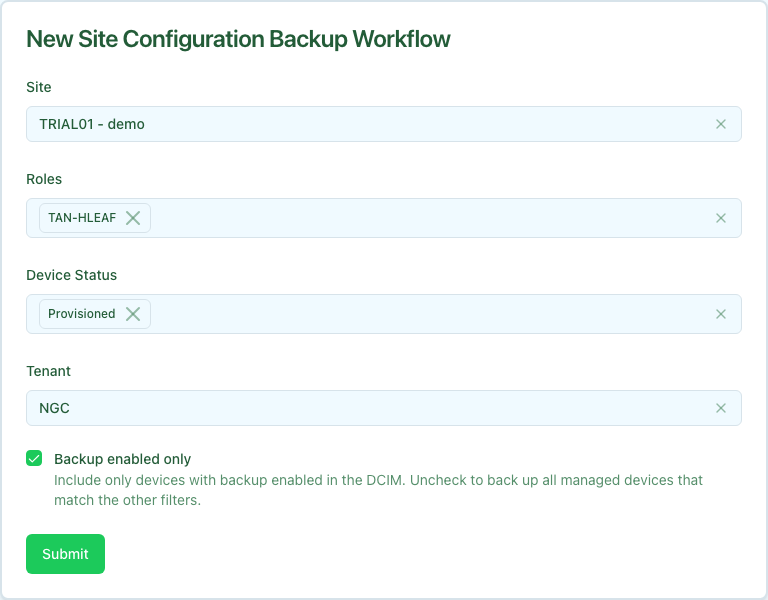

The Site Configuration Backup workflow captures running configurations for every in-scope device at a site. It fans out one [Configuration Backup](../configuration-backup/index.mdx) child workflow per device, aggregates the per-device results, and produces a consolidated report distinguishing successes, failures, and whether each backup changed the stored snapshot.

Use this workflow when you need a fresh site-wide backup outside the normal scheduled backup run—for example, before a maintenance window or broad configuration change. For a single device, use [Configuration Backup](../configuration-backup/index.mdx) directly.

## Prerequisites

Before running, confirm the following are in place for the devices you expect to include:

- **Devices exist in the configured DCIM** with primary IPv4, platform, and managed status. The workflow resolves the device list through the provider using your site, role, status, and tenant filters.
- **Devices are reachable** from Config Manager on their management addresses, and credentials are current in the secrets store.
- **Intended configurations are available** in the [Config Store](../../config-store/index.mdx) for render-enabled devices. Each child compares running config against the rendered intent. A backup-enabled device with rendering disabled skips the drift check.
- **Backup paths are configured** on device records so each child can record where the snapshot landed.
- **User attribution is present.** UI and CLI submissions populate the requesting user automatically; the workflow rejects requests with no user attached.

By default the workflow includes only devices with **backup enabled** in the configured DCIM. Uncheck **Backup enabled only** on the form to include all managed devices that match the other filters.

## Running the workflow

1. Navigate to the Config Manager URL for your environment.
1. Open the workflow launcher and select **Site Configuration Backup**.
1. Fill in the form using the field reference below and submit.



| Field | Description | Required |
| :---- | :---------- | :------- |
| **Site** | The site whose devices should be backed up. | Yes |
| **Roles** | Device roles to include (multi-select). Leave empty to include all roles. | No |
| **Device Status** | Device statuses to include (multi-select). Defaults to Active and Provisioned. | Yes |
| **Tenant** | DCIM tenant filter. | No |
| **Backup enabled only** | When checked, only devices with backup enabled are included. | No (defaults to checked) |

After submission, a status page appears showing the three stages. The middle stage updates its display incrementally as child backups complete.

You can also start the workflow from the CLI. Authenticate first, then invoke `site-backup`. See [Temporal CLI](../../temporal/temporal-cli.mdx) for login and discovery details.

```bash
uv run workflow-cli login -H config-manager.example.com

uv run workflow-cli site-backup \
  -H config-manager.example.com \
  --site rno1 \
  --roles "" \
  --status Active,Provisioned \
  --backup-enabled-only true
```

## Execution stages

The workflow runs three stages. None require manual approval at the site level.

1. **`get_devices` — Resolve the device list from the configured DCIM.**

   Calls the provider with the supplied site, role, status, tenant, and backup-enabled filters. Supported platforms are Arista EOS, Cumulus Linux, NV-OS, and Juniper Junos. The stage display lists the devices that will be backed up.

1. **`perform_backups` — Fan out a child backup per device.**

   For each device, the workflow starts a [Configuration Backup](../configuration-backup/index.mdx) child workflow with `trigger=WORKFLOW`. Children run in parallel; the stage display updates as each completes. A child that fails is recorded in the per-device result rather than stopping the run.

   These children retain interactive stage-retry behavior, unlike scheduled
   backups. A failed stage can wait for a manual retry; each child has a
   15-minute run timeout. Inspect its workflow page rather than expecting every
   device failure to appear immediately in the site summary.

1. **`format_result` — Aggregate per-device results.**

   Combines all child outcomes into a markdown summary with success, failure, changed, and unchanged counts. Each entry includes a child-workflow link or workflow ID for follow-up.

## Result structure

The workflow returns a markdown summary. Each successful device entry notes whether the backup **changed** the stored snapshot (`changed`) or matched the previous backup (`unchanged`), plus a child-workflow link or workflow ID. Failed entries include the error message and a child-workflow link or workflow ID.

## Partial failures and re-runs

A child failure does not stop the rest of the site. To recover:

1. Open the consolidated result on the workflow status page and review failed devices.
1. Click through to each child workflow to read the underlying error.
1. Resolve per-device causes (reachability, missing intended config, credentials).
1. Re-run **Site Configuration Backup** with the same inputs, or run [Configuration Backup](../configuration-backup/index.mdx) against individual devices.

Re-running the site workflow is safe. Devices that already have a current backup typically complete quickly with `unchanged` results.

## Common issues

**No devices found matching the specified filters.**

The site name, role, status, tenant, or backup-enabled filter excluded every device. Widen the filters or confirm devices are managed and on a supported platform.

**Many children fail with reachability errors.**

Management connectivity or credentials are wrong for part of the site. Fix reachability, then re-run or back up the failed devices individually.

**Drift alerts appear on child backups.**

The running configuration differs from the intended configuration in the Config Store. This is expected when devices have diverged; investigate drift on each child workflow before applying new changes.

**Missing user for backup attribution.**

The workflow was started without a user context. Submit through the UI or API with authenticated user attribution.

## Related guides

- [Configuration Backup](../configuration-backup/index.mdx) — the per-device child workflow, also runnable directly.
- [Configuration Deploy](../configuration-deploy/index.mdx) — apply intended changes after capturing a site baseline.
- [Controlling Running Workflows](../workflow-lifecycle/index.mdx) — approve, retry, or terminate long-running site backups.
