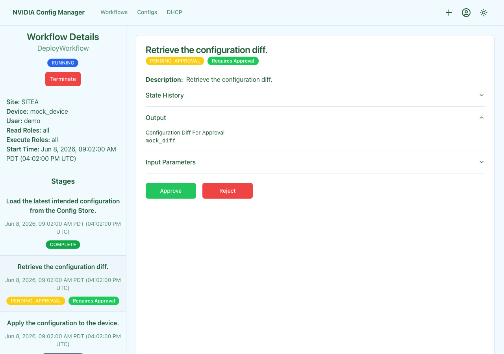

Every Config Manager workflow runs as a sequence of stages. While a workflow is running, four controls let you act on it from the Config Manager UI: **Approve**, **Reject**, **Retry**, and **Terminate**. This guide covers what each one does, when to use it, and — for terminate in particular — what state the device is left in.

For per-workflow specifics, follow the link in each workflow's guide; this page is the cross-cutting reference for the lifecycle itself.

## At a glance

| Control | Scope | When it's available | What it does |
| :------ | :---- | :------------------ | :----------- |
| **Approve** | One stage | The stage is in `PENDING_APPROVAL`. | Continues the workflow past the approval gate. |
| **Reject** | One stage | The stage is in `PENDING_APPROVAL`. | Marks downstream stages UNREACHABLE and exits the workflow without touching the device. |
| **Retry** | One stage | The stage is in `FAILED` **and** the stage is marked retryable. | Resets the stage to `IN_PROGRESS` and re-runs it from the start of that stage. |
| **Terminate** | Whole workflow | The workflow status is `RUNNING`. | Stops the workflow immediately at the Temporal layer. In-flight activities are canceled; no graceful cleanup runs. |

The Approve / Reject / Retry buttons live on the **stage details** panel for the selected stage. The Terminate button lives at the top of the **workflow details** panel, next to the workflow status badge.

## Approve

Use when a `PENDING_APPROVAL` stage is showing you the right diff or the right plan and you want the workflow to continue. Approve sends a signal to that specific stage; the workflow records the approver in its audit log and the next stage starts.

If a workflow has multiple approval stages (Multi-Deploy fans out one per batch), each child's approval is independent.

## Reject

Use when a `PENDING_APPROVAL` stage shows a diff or plan that should **not** be applied. Reject marks every downstream stage as **UNREACHABLE** and the workflow exits cleanly. The device is not touched.

Common reasons to reject:

- The diff includes unintended changes (typically the upstream Nautobot data or templates need to be fixed first).
- The maintenance window has closed.
- The proposed upgrade target or password rotation is wrong.

After fixing the upstream cause, start a new workflow — there is no way to "un-reject" an existing one.

## Retry

Use when a single stage failed in a way you believe is transient (network blip, momentary device unreachability) and you want to re-run just that stage rather than starting the whole workflow over. The stage's state must be `FAILED`, and the stage itself must be marked retryable.

Retry is not appropriate when:

- The stage failed because of a non-retryable error class (for example `ConfigSyntaxException`, `DiffChangedException`, `FirmwareUpgradeException`). These are deliberate fail-closed conditions — fix the underlying cause and run a new workflow.
- The stage isn't marked retryable (the Retry button will be disabled).
- The whole workflow already terminated. Retry signals only land on stages of a still-running workflow; for a terminated or failed-out workflow, start a new run.

## Terminate

Terminate stops the entire workflow at the Temporal layer. The button is at the top of the workflow details panel and is only enabled while the workflow's status is `RUNNING`.

**What termination actually does:**

- Sends `terminate` to the Temporal workflow handle. Temporal moves the workflow to a terminal `TERMINATED` status.
- In-flight activities are canceled. There is **no graceful unwind**, no automatic rollback, and no automatic backup.
- The device is left in whatever state the in-flight activity had reached when it was canceled. Some activities (a config push partway through, an image install mid-reboot) leave the device in a partial state that needs hands-on recovery.

**When termination is the right move:**

- A workflow is genuinely stuck (an indefinite wait on a condition that will never clear) and the alternative is leaving it hanging.
- An operator made a serious mistake on input and the workflow is past the approval gate but still on a stage that hasn't yet altered the device.
- The site is being taken down for unrelated emergency work and any in-flight orchestration needs to stop.

**When it's not:** if the workflow is still at an approval stage, **reject** instead — rejection exits cleanly and leaves nothing for you to clean up.

### Recovering after a terminate

What you need to do post-terminate depends on which stage was in flight at the moment of termination. The pattern below applies to the major workflows:

| Workflow | If terminated during... | Likely device state | Recovery |
| :------- | :---------------------- | :------------------ | :------- |
| Configuration Deploy | Diff / approval | Untouched. | None — start a new workflow if you still want to apply the change. |
| Configuration Deploy | `apply_configuration` | Partially applied; running config may not match intended. | Run [Configuration Backup](../configuration-backup/index.mdx) to capture current state, then re-run Configuration Deploy to converge. |
| Multi-Deploy / Batch Deploy | Per-batch approval | Untouched. | Start a new run with the same or a smaller scope. |
| Multi-Deploy / Batch Deploy | Apply | Per-device state may be split — some devices applied, some not. The batch result captures what landed before termination. | Re-run against the unfinished devices once you've reviewed the partial result. |
| Switch OS Upgrade | Approval, backup, or context update | Untouched (or backup recorded). | Start a new run. |
| Switch OS Upgrade | `perform_upgrade` (after the image push or reboot) | Device may be mid-install or mid-ZTP. | Wait for ZTP to converge; if it doesn't, run [Device Reprovision](../reprovision/index.mdx). |
| NVLink Firmware Upgrade | Approval, backup, or context update | Untouched (or backup recorded). | Start a new run. |
| NVLink Firmware Upgrade | `execute_firmware_upgrade` | Device may be mid-install or mid-reboot. | Wait for the device to come back; verify firmware with the platform's `nv show` command; reprovision if unrecoverable. |
| Password Rotation (device or site) | Diff / auto-approval | Untouched. | None. |
| Password Rotation (device or site) | `apply_configuration` | Some devices may have the new password, others the old. | Try logging in with both credentials; rotate the rest with a fresh run. If a device is unreachable on either password, recover via [breakglass / console](../new-site-deployment/index.mdx#options-for-logging-into-a-stuck-device). |
| Cable / Hardware Validation | Any stage | Untouched. These workflows are read-only. | None — re-run if you still want the report. |
| Reprovision | Any stage | Device may be mid-ZTP. | Wait for ZTP to converge; if it doesn't, run reprovision again. |

If you're not sure what stage was running at the time of termination, open the workflow's stage list in the UI — every stage shows its state at the moment the workflow stopped. The last stage in `IN_PROGRESS` (or the one most recently transitioned to `FAILED`) is what was active when terminate landed.

## Audit and history

Every Approve / Reject / Retry / Terminate is logged in the workflow's history. Open the workflow detail page to see who did what and when. For deeper investigation, the underlying Temporal history is accessible via the [Temporal API](../../temporal/temporal-api.mdx) or [Temporal CLI](../../temporal/temporal-cli.mdx).

## Related guides

- [Configuration Deploy](../configuration-deploy/index.mdx) — the canonical workflow with an approval gate.
- [Multi-Deploy](../multi-deploy/index.mdx) and [Batch Deploy](../batch-deploy/index.mdx) — fanned-out approvals across many devices.
- [Switch OS Upgrade](../switch-os-upgrade/index.mdx), [NVLink Switch Firmware Upgrade](../nvlink-switch-firmware-upgrade/index.mdx) — workflows where mid-flight terminate has the largest device-state impact.
- [Device Reprovision](../reprovision/index.mdx) — the standard recovery path when a device is left in an unrecoverable state.
